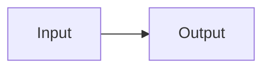

# Tutorial Markdown Directives & Frontmatter Reference

This reference documents the YAML frontmatter schemas and custom Markdown directives compiled by [`tutorial/build.py`](../../../../tutorial/build.py).

---

## 1. YAML Frontmatter Schemas

### Lesson (`tutorial/lessons/<NNNN-slug>.md`)

```yaml
---
type: lesson
id: "0007"
title: "4HP Eurorack Front Panel Generator & Mechanical Alignment"
kicker: "Lesson 0007 · Mechanical CAD & Front Panel Generation"
lead: "Why do audio jack holes on a Eurorack faceplate fail to line up..."
badge: "ERC: 0 Errors · Panel Plan Verified"
summary: "Compute the +6.48mm WQP-PJ398SM (Thonkiconn) sleeve-to-bushing offset..."
app_dir: "./apps/0007-eurorack-front-panel-generator"
meta:
  - label: "Prerequisite"
    html: '<a href="0006-kicad-pcb-layout-and-assembly.html">Lesson 0006: 4HP KiCad 10 PCB Layout</a>'
  - label: "Runnable App"
    code: "tutorial/apps/0007-eurorack-front-panel-generator/"
  - label: "Panel Spec"
    code: "20.0 × 128.5 mm (Doepfer 3U × 4HP)"
prev:
  slug: "0006-kicad-pcb-layout-and-assembly"
  title: "0006: From .net Netlist to 4HP KiCad 10 PCB Layout & Assembly"
next:
  slug: "0008-prefab-design-review-and-drc"
  title: "0008: Programmatic Pre-Fab Design Review, DRC & Gerber Audit"
---
```

### Reference Sheet (`tutorial/reference/*.md`)

```yaml
---
type: reference
id: "skidl-cheatsheet"
title: "SKiDL API & Pin Indexing Cheat Sheet"
nav_label: "SKiDL Ref"
kicker: "Reference Sheet · Printable Quick Guide"
lead: "Fast lookup for SKiDL imports, Part instantiation, template cloning..."
card_title: "SKiDL API & Pin Indexing Cheat Sheet"
card_desc: "Imports, Part(..., dest=TEMPLATE), numeric pin indexing..."
order: 1
---
```

> Note: `tutorial/reference/GLOSSARY.md` uses `output: "glossary.html"` in its frontmatter and automatically renders `**Term**:` entries as `<dl><dt>...</dt><dd>...</dd></dl>`.

---

## 2. Custom Block & Inline Directives

### Callout Boxes (`:::callout`, `:::callout-warn`, `:::callout-success`)

```markdown
:::callout Mission Connection
Your single-paragraph or multi-line callout body here.
:::
```

### Fenced Code Figures & Mermaid Diagrams

Add `title="..."` on any fenced code block to wrap it in `<figure class="code-figure">` with a header bar and Copy button (pass `copy=false` for terminal output blocks):

````markdown
```python title="tutorial/apps/0001-environment-and-kicad-bootstrap/verify_env.py"
print("Hello SKiDL")
```

```bash title="Verified Output · verify_env.py" copy=false
ERC INFO: No errors or warnings found while running ERC.
```


````

### Captioned Tables (`Table: ...`)

Place `Table: Caption text` on the line immediately before a pipe table to wrap it in `<div class="table-wrap">` with a `<caption>`:

```markdown
Table: Eurorack 10-Pin Power Header Pinout

| Pin(s) | Net | Function |
| :--- | :--- | :--- |
| `1, 2` | `-12V_RAW` | Negative supply rail |
```

### Interactive Fill-in-the-Blank Exercises (`:::exercise` & `{{blank:...}}`)

Use `{{blank:answer|hint|aria_label|size}}` inside a fenced code block within `:::exercise`. If a blank accepts multiple valid answers, separate alternatives with `/` inside `answer` (e.g., `128.5/128.50`):

````markdown
:::exercise id="ex-0007-title" title="Retrieval Practice: Bushing Offset & Doepfer 3U Panel Math"
Fill in the blanks below:

```python
PANEL_HEIGHT_3U_MM = {{blank:128.5/128.50|Standard 3U Eurorack panel height in mm: 128.50|Doepfer 3U panel height in mm|7}}
```
:::
````

### Multiple-Choice Retrieval Quizzes (`:::quiz`)

Every option within a single question **must have the exact same word count** (enforced by `tutorial/build.py --check`):

```markdown
:::quiz id="quiz-0007-title" title="Knowledge Check"
1. Question prompt here?
- [x] Eight word option text that is correct here. | Explanation shown when selected.
- [ ] Eight word option text that is wrong one. | Explanation shown when selected.
- [ ] Eight word option text that is wrong two. | Explanation shown when selected.
- [ ] Eight word option text that is wrong three. | Explanation shown when selected.
:::
```

### Interactive Widgets (`{{widget:...}}`)

Place on its own line:
- `{{widget:lesson-cards}}` — Renders the `.lesson-grid` of all lessons on `tutorial/index.md`
- `{{widget:reference-cards}}` — Renders the `.lesson-grid` of all reference sheets on `tutorial/index.md`
- `{{widget:part-explorer}}` — Renders `#part-explorer` (Lesson `0002`)
- `{{widget:normalling-sim}}` — Renders `#normalling-sim` (Lesson `0005`)
- `{{widget:panel-bushing-calc}}` — Renders `#panel-bushing-calc` (Lesson `0007`)
