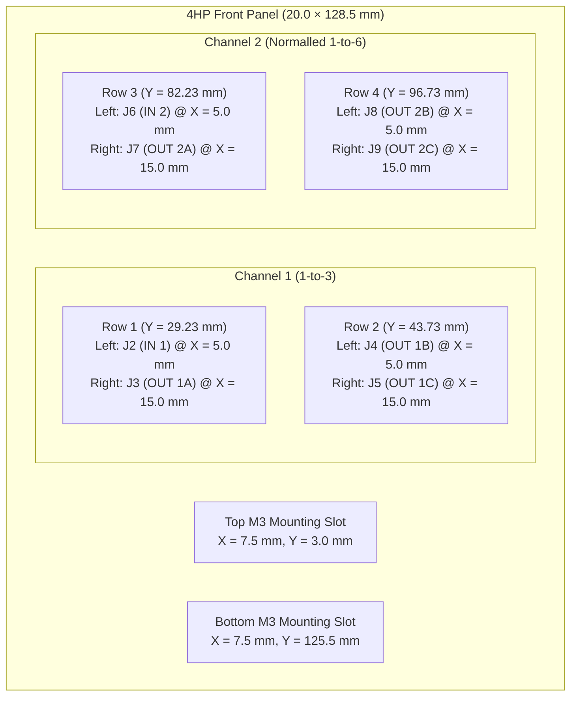

# KiCad 10 Eurorack Front Panel Plan — Buffered Multiple (4HP)

This guide plans out the design and fabrication of a **4HP (3U) Eurorack Front Panel** in **KiCad 10** (`BufferedMult_Panel.kicad_pcb`) to mate directly with [`BufferedMult.kicad_pcb`](BufferedMult.kicad_pcb).

---

## 1. Mechanical & Alignment Specifications

- **Main PCB (`BufferedMult.kicad_pcb`)**: `20.0 × 108.0 mm` (4HP), with `Edge.Cuts` spanning `(20.0, 20.0)` to `(40.0, 128.0)`.
- **Front Panel (`BufferedMult_Panel.kicad_pcb`)**: **`20.0 × 128.5 mm`** (Doepfer A-100 3U × 4HP standard), `1.6 mm` FR-4 (or `2.0 mm` aluminum).
- **Vertical PCB-to-Panel Centering**: Centering the `108.0 mm` main PCB behind the `128.5 mm` front panel gives **`10.25 mm`** of clearance at both the top and bottom edges (`(128.5 - 108.0) / 2 = 10.25 mm`), clearing standard `~7.5 mm` Eurorack rail lips with `2.75 mm` to spare.
- **Board-to-Panel Standoff Height**: The 8× `WQP-PJ398SM` (Thonkiconn) jacks establish a **`10.5 mm`** spacing between the front surface of `BufferedMult.kicad_pcb` (`F.Cu`) and the rear surface of the front panel (`B.Cu`), which clears the `7.0 mm` tall radial electrolytic bulk capacitors (`C1`, `C2` on `F.Cu`) by `3.5 mm`.
- **Thonkiconn Bushing Offset (`+6.48 mm` in Y)**:
  - In KiCad's `Connector_Audio:Jack_3.5mm_QingPu_WQP-PJ398SM_Vertical_CircularHoles` footprint (all placed at `rotation = 0` on `F.Cu`), the footprint origin `(0, 0)` is **Pad `S` (Sleeve)**.
  - The **threaded M6 bushing shaft center** (`fp_circle`) is offset by **`(0, +6.48 mm)`** relative to the footprint origin.
  - All front-panel jack holes must be placed at the **bushing center** coordinates below.

### Coordinate Table

The table below provides coordinates in both:
1. **Main PCB Coordinate Space** — where the main PCB spans `X = 20.0..40.0 mm`, `Y = 20.0..128.0 mm`, and the centered front panel spans `X = 20.0..40.0 mm`, `Y = 9.75..138.25 mm`.
2. **Panel-Local Coordinate Space** — where the top-left corner of the front panel is `(0.0, 0.0)` and the bottom-right corner is `(20.0, 128.5)` (`X_panel = X_pcb - 20.0`, `Y_panel = Y_pcb - 9.75`).

| Feature | Ref / Function | Main PCB Footprint `(X, Y)` | Main PCB Bushing `(X, Y)` | **Panel-Local `(X, Y)`** *(Top-Left = `0, 0`)* | Hole / Cutout Size |
| :--- | :--- | :---: | :---: | :---: | :--- |
| **Panel Outline** | 4HP × 3U Doepfer Standard | `X: 20.0..40.0` `Y: 9.75..138.25` | — | **`0.0, 0.0` → `20.0, 128.5 mm`** | `0.5 mm` corner fillets (optional) |
| **Top Rack Slot** | M3 Rail Screw | `(27.50, 12.75)` | — | **`(7.50, 3.00 mm)`** | `3.2 × 5.5 mm` NPTH oval slot (or `3.2 mm` hole) |
| **Bottom Rack Slot** | M3 Rail Screw | `(27.50, 135.25)` | — | **`(7.50, 125.50 mm)`** | `3.2 × 5.5 mm` NPTH oval slot (or `3.2 mm` hole) |
| **Row 1 — Left** | **`J2` (`IN 1`)** | `(25.00, 32.50)` | `(25.00, 38.98)` | **`(5.00, 29.23 mm)`** | `6.2 mm` – `6.3 mm` NPTH hole |
| **Row 1 — Right** | **`J3` (`OUT 1A`)** | `(35.00, 32.50)` | `(35.00, 38.98)` | **`(15.00, 29.23 mm)`** | `6.2 mm` – `6.3 mm` NPTH hole |
| **Row 2 — Left** | **`J4` (`OUT 1B`)** | `(25.00, 47.00)` | `(25.00, 53.48)` | **`(5.00, 43.73 mm)`** | `6.2 mm` – `6.3 mm` NPTH hole |
| **Row 2 — Right** | **`J5` (`OUT 1C`)** | `(35.00, 47.00)` | `(35.00, 53.48)` | **`(15.00, 43.73 mm)`** | `6.2 mm` – `6.3 mm` NPTH hole |
| **Row 3 — Left** | **`J6` (`IN 2`)** | `(25.00, 85.50)` | `(25.00, 91.98)` | **`(5.00, 82.23 mm)`** | `6.2 mm` – `6.3 mm` NPTH hole |
| **Row 3 — Right** | **`J7` (`OUT 2A`)** | `(35.00, 85.50)` | `(35.00, 91.98)` | **`(15.00, 82.23 mm)`** | `6.2 mm` – `6.3 mm` NPTH hole |
| **Row 4 — Left** | **`J8` (`OUT 2B`)** | `(25.00, 100.00)` | `(25.00, 106.48)` | **`(5.00, 96.73 mm)`** | `6.2 mm` – `6.3 mm` NPTH hole |
| **Row 4 — Right** | **`J9` (`OUT 2C`)** | `(35.00, 100.00)` | `(35.00, 106.48)` | **`(15.00, 96.73 mm)`** | `6.2 mm` – `6.3 mm` NPTH hole |

---

## 2. Step-by-Step KiCad 10 Workflow

### Step 1: Create a Standalone Panel Board (`BufferedMult_Panel.kicad_pcb`)
Creating a standalone `.kicad_pcb` file (no schematic required) allows you to order the front panel with its own solder-mask color (e.g., matte black with gold ENIG or white silkscreen) and order quantity without modifying [`BufferedMult.kicad_pcb`](BufferedMult.kicad_pcb):
1. Open KiCad 10 **PCB Editor** (`pcbnew`) and save a new board as `BufferedMult_Panel.kicad_pcb`.
2. Set the grid origin to `(0, 0)` (or temporarily use the main PCB's coordinate space so you can paste footprints between boards at identical coordinates to verify alignment).

### Step 2: Draw the 4HP × 3U Outline on `Edge.Cuts`
1. Select the **`Edge.Cuts`** layer.
2. Draw a rectangle from **`(0.0, 0.0)`** to **`(20.0, 128.5 mm)`** (width = `20.0 mm`, height = `128.5 mm`).
3. *(Optional)* Add `0.5 mm` corner fillets to soften the panel corners.

### Step 3: Place the 8 Jack Holes & 2 Rack Mounting Slots
Use non-plated through-hole (`NPTH`) footprints so holes and slots are exported cleanly in the Excellon drill file:
1. **8× Thonkiconn (`WQP-PJ398SM`) Jack Holes**:
   - Place 8 `NPTH` pads with a **`6.2 mm` circular drill** at the 8 jack coordinates in the table above (`X = 5.0 mm` and `X = 15.0 mm`; `Y = 29.23, 43.73, 82.23, 96.73 mm`).
   - Draw a **`9.5 mm` diameter (`4.75 mm` radius)** reference circle on **`F.Fab`** or **`User.Drawings`** around each hole center to represent the outer diameter of the M6 knurled/hex nut so text and graphics remain outside the nut footprint.
2. **2× Eurorack M3 Mounting Slots**:
   - Place two `NPTH` oval slots (`5.5 mm × 3.2 mm` slot size, `5.5 mm × 3.2 mm` pad size) centered at **`(7.50, 3.00 mm)`** and **`(7.50, 125.50 mm)`**.

### Step 4: Front Panel Graphics, Labels & Ground Shielding
A standard FR-4 PCB front panel offers three high-contrast visual layers:
1. **Silkscreen (`F.Silkscreen`)**:
   - **Module Title**: Place `BUF MULT` or `1:3 / 1:6` centered horizontally (`X = 10.0 mm`) near `Y = 12.0 mm`.
   - **Jack Labels**: Place labels (`IN 1`, `1A`, `1B`, `1C`, `IN 2`, `2A`, `2B`, `2C`) at least `5.5 mm` above or below each jack hole center so they are not obscured by the M6 nuts:
     - Row 1 labels above holes at **`Y = 23.0 mm`** (`IN 1` at `X = 5.0 mm`, `OUT 1A` at `X = 15.0 mm`)
     - Row 2 labels below holes at **`Y = 50.0 mm`** (`OUT 1B` at `X = 5.0 mm`, `OUT 1C` at `X = 15.0 mm`)
     - Row 3 labels above holes at **`Y = 76.0 mm`** (`IN 2` at `X = 5.0 mm`, `OUT 2A` at `X = 15.0 mm`)
     - Row 4 labels below holes at **`Y = 103.0 mm`** (`OUT 2B` at `X = 5.0 mm`, `OUT 2C` at `X = 15.0 mm`)
   - **Normalled Cascade Graphic (`CH1 → IN 2`)**: Use the `38.5 mm` vertical span between Row 2 (`Y = 43.73 mm`) and Row 3 (`Y = 82.23 mm`) to draw a vertical normalling line/arrow indicating that Channel 1 cascades into `IN 2` when `IN 2` is unpatched.
2. **Input Jack Visual Callout (`IN 1` & `IN 2`)**:
   - Draw a filled silkscreen badge (or exposed ENIG gold/HASL ring on **`F.Cu` + `F.Mask`**) around **`J2` (`IN 1`)** at `(5.00, 29.23 mm)` and **`J6` (`IN 2`)** at `(5.00, 82.23 mm)` to visually distinguish inputs from outputs.
3. **Copper Shielding & Panel Grounding (`F.Cu` & `B.Cu`)**:
   - Pour solid copper zones across both **`F.Cu`** (tented under solder mask) and **`B.Cu`** (with `0.4 mm` edge pullback) to block light bleed through the FR-4 substrate and stiffen the panel.
   - *(Optional)* Add an exposed copper ring (`B.Mask` opening, `9.0 mm` outer diameter) on **`B.Cu`** around the back of the jack holes—or convert the jack holes to plated through-holes (`PTH`) tied to the copper pour—so tightening the jack nuts grounds the panel copper planes directly to the jack sleeves (`GND`).
   - Add a PCB manufacturer order-number placeholder text **`JLCJLCJLCJLC`** on **`B.Silkscreen`** so the fab house places the production barcode on the rear face of the panel rather than the front.

### Step 5: Mechanical Verification & Gerber Export
1. **Overlay Alignment Check**:
   - Temporarily copy the panel outline and 8 jack hole circles onto `User.Eco1` of [`BufferedMult.kicad_pcb`](BufferedMult.kicad_pcb) at `(20.0, 9.75)` to `(40.0, 138.25)` and verify that all 8 `6.2 mm` holes sit concentrically around the `fp_circle` bushing centers of `J2`–`J9`.
2. **Design Rules Check (`DRC`)**:
   - Run `kicad-cli pcb drc BufferedMult_Panel.kicad_pcb` and verify `0` errors.
3. **Export Fabrication Outputs (`production/panel/`)**:
   - Plot Gerber layers (`F.Cu`, `B.Cu`, `F.Silkscreen`, `B.Silkscreen`, `F.Mask`, `B.Mask`, `Edge.Cuts`) and Excellon drill files (`PTH` and `NPTH`) into `production/panel/`, then zip as `production/BufferedMult_Panel.zip`.
