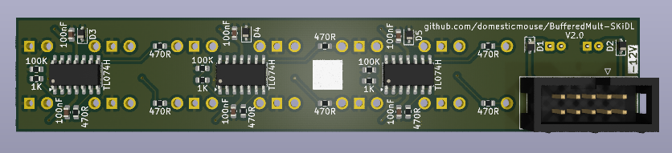
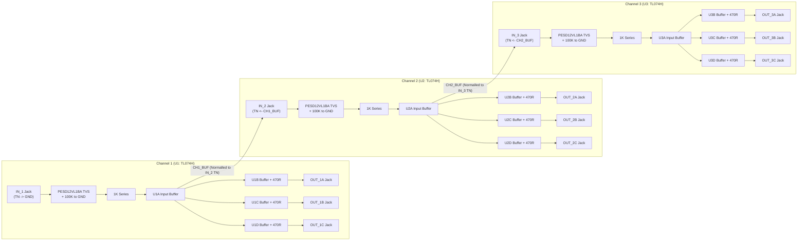

# Eurorack Buffered Multiple (SKiDL + KiCad 10)

A precision **Triple 1-to-3 (Normalized to 1-to-6 / 1-to-9) Eurorack Buffered Multiple** designed in Python using [SKiDL](https://devbisme.github.io/skidl/) and targeting **KiCad 10**.

This project is a SKiDL re-implementation and 3-channel expansion of [domesticmouse/Buffered-Mult](https://github.com/domesticmouse/Buffered-Mult), omitting the LED feedback circuitry.

**Interactive Course & Tutorial:** [**https://domesticmouse.github.io/BufferedMult-SKiDL/**](https://domesticmouse.github.io/BufferedMult-SKiDL/) *(published via GitHub Pages from [`tutorial/`](tutorial/))*



---

## Features & Architecture

- **Triple 1-to-3 / Cascaded 1-to-6 / 1-to-9 Routing**:
  - **Channel 1**: 1 input (`IN_1`) driving 3 individually buffered outputs (`OUT_1A`, `OUT_1B`, `OUT_1C`). When `IN_1` is unpatched, its normalled switch contact (`TN`) grounds the input to `0V`.
  - **Channel 2**: 1 input (`IN_2`) driving 3 individually buffered outputs (`OUT_2A`, `OUT_2B`, `OUT_2C`). When `IN_2` is unpatched, its normalled switch contact (`TN`) receives the buffered signal from Channel 1 (`CH1_BUF`), cascading Channels 1 and 2 into a **1-to-6 buffered multiple** with zero loading droop between channels. Patching a cable into `IN_2` breaks the normal connection for independent channel operation.
  - **Channel 3**: 1 input (`IN_3`) driving 3 individually buffered outputs (`OUT_3A`, `OUT_3B`, `OUT_3C`). When `IN_3` is unpatched, its normalled switch contact (`TN`) receives the buffered signal from Channel 2 (`CH2_BUF`), cascading all three channels into a **1-to-9 buffered multiple** (or a **1-to-3 + 1-to-6** split if `IN_2` is patched while `IN_3` is unpatched). Patching a cable into `IN_3` breaks the normal connection for independent triple 1-to-3 operation.
- **Dedicated Input & Output Buffering**:
  - Each channel uses one quad `TL074H` (`TL074HIDR`) op-amp (`SOIC-14`):
    - **Stage A**: Unity-gain input follower protected by a `PESD12VL1BA` (`SOD-323`) bidirectional 12V TVS/ESD diode, a `100K` input pull-down resistor (`0603`), and a `1K` series input current-limiting resistor (`0603`).
    - **Stages B, C, D**: Three independent unity-gain output followers, each isolated with a `470R` series output protection resistor (`0603`).
- **Eurorack Power Supply Protection**:
  - Standard 10-pin (`2x5`) through-hole shrouded IDC power header (`±12V`, `GND`).
  - Reverse-polarity protection via `1N5819WS` Schottky diodes (`SOD-323`, or `B5819W` in `SOD-123` as a larger alternative).
  - `10uF` radial through-hole electrolytic bulk bypass capacitors per rail plus `100nF` (`0603`) local ceramic decoupling capacitors at each op-amp's `V+` and `V-` pins.

### Signal Flow



---

## Bill of Materials (BOM)

The design separates **SMT components** (factory-assembled on `B.Cu` by JLCPCB) from **Through-Hole (THT) components** (hand-soldered after receiving the boards):

| Ref | Qty | Value / Part | Package / Footprint | KiCad Symbol | LCSC Part # | Assembly / Description |
| :--- | --: | :--- | :--- | :--- | :--- | :--- |
| `U1`–`U3` | 3 | `TL074H` (`TL074HIDR`) | `Package_SO:SOIC-14_3.9x8.7mm_P1.27mm` | `Amplifier_Operational:TL074` | `C2878713` | **SMT (`B.Cu`, Extended)** — Quad Low-Noise High-Voltage Op-Amp |
| `D1`, `D2` | 2 | `1N5819WS` | `Diode_SMD:D_SOD-323` | `Device:D_Schottky` | `C191023` | **SMT (`B.Cu`, Basic)** — Schottky Reverse-Polarity Protection Diode *(Alt larger package: `B5819W` in `Diode_SMD:D_SOD-123`, LCSC `C8598`, Basic)* |
| `D3`–`D5` | 3 | `PESD12VL1BA` (`PESD12VL1BA,115`) | `Diode_SMD:D_SOD-323` | `Device:D_TVS` | `C38558` | **SMT (`B.Cu`, Extended)** — 12V Bidirectional Low-Capacitance (`19 pF`, `<50 nA`) Input ESD/TVS Protection Diode *(Alt 15V: `PESD15VL1BA,115` / `C85378`; Basic SOD-123FL: `SMF12CA` / `C19077508`)* |
| `C3`–`C8` | 6 | `100nF` (`50V X7R`) | `Capacitor_SMD:C_0603_1608Metric` | `Device:C` | `C14663` | **SMT (`B.Cu`, Basic)** — Ceramic Decoupling Capacitor (`CC0603KRX7R9BB104`) |
| `R1`, `R6`, `R11` | 3 | `100K` (`1%`) | `Resistor_SMD:R_0603_1608Metric` | `Device:R` | `C25803` | **SMT (`B.Cu`, Basic)** — Input Pull-Down Resistor (`0603WAF1003T5E`) |
| `R2`, `R7`, `R12` | 3 | `1K` (`1%`) | `Resistor_SMD:R_0603_1608Metric` | `Device:R` | `C21190` | **SMT (`B.Cu`, Basic)** — Input Series Overvoltage / ESD Current-Limiting Resistor (`0603WAF1001T5E`) |
| `R3`–`R5`, `R8`–`R10`, `R13`–`R15` | 9 | `470R` (`1%`) | `Resistor_SMD:R_0603_1608Metric` | `Device:R` | `C23179` | **SMT (`B.Cu`, Basic)** — Output Series Protection Resistor (`0603WAF4700T5E`) |
| `J2`–`J13` | 12 | `WQP-PJ398SM` | `Connector_Audio:Jack_3.5mm_QingPu_WQP-PJ398SM_Vertical_CircularHoles` | `Connector_Audio:AudioJack2_SwitchT` | — | **THT (`F.Cu`, Hand-Soldered)** — 3.5mm Mono Switched Eurorack Jack (Thonkiconn) |
| `C1`, `C2` | 2 | `10uF` (`25V`) | `Capacitor_THT:CP_Radial_D5.0mm_P2.00mm` | `Device:C_Polarized` | `C713347` | **THT (`F.Cu`, Hand-Soldered)** — Radial Electrolytic Bulk Cap (`ECEA1EKS100`) |
| `J1` | 1 | `EURORACK_PWR_10PIN` | `Connector_IDC:IDC-Header_2x05_P2.54mm_Vertical` | `Connector_Generic:Conn_02x05_Odd_Even` | — | **THT (`B.Cu`, Hand-Soldered)** — 10-Pin (`2x5`) Shrouded Eurorack Power Header |

---

## Getting Started

### Prerequisites

- **KiCad 10** installed (default macOS symbol/footprint path `/Applications/KiCad/KiCad.app/Contents/SharedSupport/` is detected automatically by `buffered_multiple.py`).
- **Python 3.12–3.14** and [`uv`](https://docs.astral.sh/uv/).

### Setup & Run

1. **Create the virtual environment and install SKiDL**:
   ```bash
   uv venv --clear --python 3.14 .venv
   uv pip install skidl
   ```

2. **Generate the circuit outputs and run Electrical Rules Checking (ERC)**:
   ```bash
   .venv/bin/python buffered_multiple.py
   ```

3. **Generate or update the 4HP Eurorack front panel PCB and Gerbers**:
   ```bash
   /Applications/KiCad/KiCad.app/Contents/Frameworks/Python.framework/Versions/Current/bin/python3 \
       .agents/skills/eurorack-panel/scripts/generate_eurorack_panel.py \
       --main-pcb BufferedMult.kicad_pcb \
       --output BufferedMult_Panel.kicad_pcb \
       --title "BUF MULT" \
       --subtitle "1:3 / 1:6 / 1:9" \
       --gerber-dir production/panel \
       --zip production/BufferedMult_Panel.zip \
       --drc
   ```

4. **Build and validate the interactive tutorial HTML from Markdown** (optional, for local previewing; GitHub Actions automatically builds and publishes to [**GitHub Pages**](https://domesticmouse.github.io/BufferedMult-SKiDL/) via [`.github/workflows/pages.yml`](.github/workflows/pages.yml)):
   ```bash
   .venv/bin/python tutorial/build.py --check
   ```

5. **Lint and format with `ruff`**:
   ```bash
   ruff check --fix buffered_multiple.py buffered_multiple_sklib.py tutorial/build.py && ruff format buffered_multiple.py buffered_multiple_sklib.py tutorial/build.py
   ```

---

## Generated Files

Running `buffered_multiple.py` produces:

- **`buffered_multiple.net`** — KiCad 10 netlist with deterministic hierarchical `tstamps` and `Power` / `Signal` net classes.
- **`buffered_multiple_bom.xml`** — KiCad XML Bill of Materials.
- **`buffered_multiple_jlcpcb_bom.csv`** — Grouped JLCPCB SMT PCBA Bill of Materials (`Comment,Designator,Footprint,LCSC Part #`), excluding hand-soldered THT parts by default.
- **`buffered_multiple.erc`** / **`buffered_multiple.log`** — SKiDL ERC report and execution log (`0` errors, `0` warnings).
- **`buffered_multiple_sklib.py`** — Auto-generated SKiDL backup symbol library.

---

## KiCad 10 PCBs & Fabrication Outputs

Both the main circuit board and a mated 3U × 4HP Eurorack front panel are included in the repository:

- **Main Circuit PCB ([`BufferedMult.kicad_pro`](BufferedMult.kicad_pro) / [`BufferedMult.kicad_pcb`](BufferedMult.kicad_pcb))**:
  - **Dimensions**: `20.0 × 109.0 mm` (4HP, Rev `V2.0`), 2-layer PCB with stitched `F.Cu` and `B.Cu` `GND` planes and `0.5 mm` `±12V` power spines.
  - **Assembly**: Full 3-channel (44-component) layout with single-sided SMT placement on `B.Cu` (29 SMD parts) and hand-soldered THT jacks/bulk caps on `F.Cu` (`J2`–`J13`, `C1`, `C2`) plus the 10-pin power header on `B.Cu` (`J1`), complete with a `-12V` orientation knockout, `V2.0` revision marking, and repository URL on `B.SilkS`.
- **4HP Eurorack Front Panel ([`BufferedMult_Panel.kicad_pro`](BufferedMult_Panel.kicad_pro) / [`BufferedMult_Panel.kicad_pcb`](BufferedMult_Panel.kicad_pcb))**:
  - **Dimensions**: `20.0 × 128.5 mm` (Doepfer A-100 3U × 4HP standard).
  - **Features**: 12× `6.2 mm` PTH grounded jack cutouts aligned to the `+6.48 mm` `WQP-PJ398SM` (Thonkiconn) bushing centers (`14.40 mm` uniform vertical row pitch), 2× `3.2 × 5.5 mm` NPTH M3 mounting slots, exposed `F.Mask` copper/finish graphics (`BUF MULT` title, input callout badges for `IN 1` / `IN 2` / `IN 3`, and normalling cascade indicators), `F.SilkS` jack labels and `TL074` callout, and solid `F.Cu` / `B.Cu` copper shield planes with exposed rear ground rings.
- **Fabrication Archives (`production/`)**:
  - [`production/BufferedMult.zip`](production/BufferedMult.zip) — Main PCB Gerbers and Excellon drill files.
  - [`production/BufferedMult_Panel.zip`](production/BufferedMult_Panel.zip) — 4HP Front Panel Gerbers and Excellon drill files (also unpacked in `production/panel/`).
  - [`production/positions.csv`](production/positions.csv), [`production/bom.csv`](production/bom.csv), [`production/designators.csv`](production/designators.csv), [`production/netlist.ipc`](production/netlist.ipc) — Fabrication Toolkit pick-and-place, BOM, and IPC-D-356 netlist files (use [`buffered_multiple_jlcpcb_bom.csv`](buffered_multiple_jlcpcb_bom.csv) for SMT-only JLCPCB assembly).

---

## Documentation & Guides

- **[Interactive Tutorial on GitHub Pages (`domesticmouse.github.io/BufferedMult-SKiDL`)](https://domesticmouse.github.io/BufferedMult-SKiDL/)** — Live 8-lesson (`0001`–`0008`) interactive HTML & Python/SKiDL course with 4 reference sheets and runnable per-lesson apps ([`tutorial/apps/`](tutorial/apps/)), walking through building [`buffered_multiple.py`](buffered_multiple.py), programmatic KiCad 10 / JLCPCB component discovery, PCB layout, front-panel generation, and pre-fab DRC reviews (authored in [`tutorial/index.md`](tutorial/index.md) and compiled via [`tutorial/build.py`](tutorial/build.py)).
- **[`PCB_LAYOUT_GUIDE.md`](PCB_LAYOUT_GUIDE.md)** — Step-by-step KiCad 10 PCB layout, component placement, routing, and JLCPCB export guide.
- **[`FRONT_PANEL_GUIDE.md`](FRONT_PANEL_GUIDE.md)** — 4HP Eurorack front panel mechanical dimensions, bushing offset coordinate table, and automated generation workflow.
- **[`DESIGN_REVIEW.md`](DESIGN_REVIEW.md)** — Full schematic, PCB, DRC, Gerber, and EMC pre-compliance design review report.

---

## License

Licensed under the Apache License, Version 2.0. See [LICENSE.txt](LICENSE.txt) for details.

*This is not an official Google product.*
